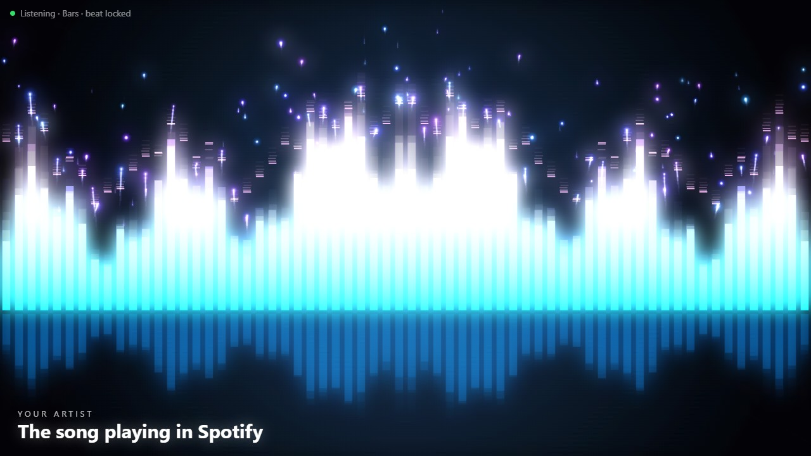
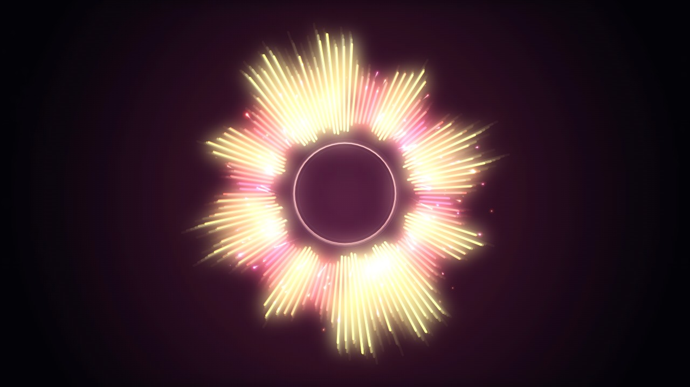
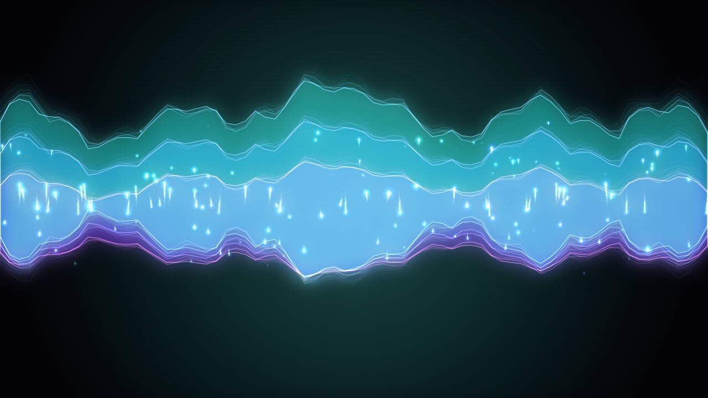

# Music Visualizer

**A neon music visualizer for Windows that dances to whatever you're playing: Spotify, YouTube, games, anything.**



## About

Spotify's own audio stream is locked, so most visualizers can't see it. This one listens the way your speakers do: it captures the sound Windows is sending to your speakers or headphones and turns it into light, live, on your own PC.

- **Works with the Spotify desktop app** and anything else making sound: YouTube, games, local music files.
- **Four modes:** Bars, Halo, Aurora and Warp, with glowing trails and sparks.
- **Locks onto the beat:** once it hears a steady rhythm, it predicts each kick, so flashes land right on the beat instead of trailing behind.
- **Shows the current Spotify song,** read from the Spotify window. No Spotify login or account linking needed.
- **Light on your laptop:** plain 2D drawing at up to 60 fps, about a tenth of one CPU core for the listening part, and it stops drawing when the music stops.
- **Private:** everything runs on your PC. Nothing is uploaded, and it doesn't need the internet once it's installed.
- **Opens like an app,** in its own window with no browser tabs. It shuts itself down when you close it.

## Screenshots

| Halo | Aurora | Warp |
|---|---|---|
|  |  |  |
| A spinning ring of bars that sparks on every kick | Layered ribbons of light that ripple with the music | Fly through stars; the louder it gets, the faster you go |

## What you need

- **Windows 10 or 11.** It uses Windows' own way of recording what your speakers play.
- **Python 3.10 or newer.** It's free; step 1 below shows how to install it.
- **Microsoft Edge** (built into Windows) or Google Chrome, for the app window.
- An internet connection **only for installing**.

## Installation

### 1. Install Python (skip if you already have it)

1. Go to [python.org/downloads](https://www.python.org/downloads/) and click **Download Python 3.x**.
2. Run the installer. On the first screen, **tick "Add python.exe to PATH"**. This matters: without it, the commands below won't work.
3. Click **Install Now** and wait for it to finish.
4. Check that it worked: open **Terminal** (press Start, type `Terminal`, press Enter) and run:
   ```
   python --version
   ```
   You should see something like `Python 3.13.1`.

### 2. Download the visualizer

**Option A, no git needed:**
1. On this GitHub page, click the green **Code** button → **Download ZIP**.
2. Right-click the downloaded ZIP → **Extract All…**, and choose a folder, for example `D:\music-visualizer`.

**Option B, with git:**
```
git clone https://github.com/likhith825/music-visualizer.git
```

### 3. Run the soundcheck (one time)

In the visualizer folder, double-click **`soundcheck.bat`**. It:
1. Checks that Python is installed.
2. Installs the two packages it needs: **numpy** (for the sound maths) and **PyAudioWPatch** (a ~100 KB package that records what your speakers play).
3. Puts a **Music Visualizer** shortcut with the neon icon on your desktop.
4. Opens the visualizer as an app.

**From then on, just double-click the Music Visualizer icon on your desktop,** like any other app. Then **play something in Spotify** (or anywhere) and watch it go.

You can also right-click the desktop icon and pin it to Start or the taskbar. If you ever move the visualizer folder, run `soundcheck.bat` again to fix the shortcut.

**Start it when you log in (optional):** press `Win + R`, type `shell:startup`, press Enter, and copy the desktop shortcut into the folder that opens.

### Other ways to start it

- **In your web browser:** double-click **`play.bat`**. It opens `http://127.0.0.1:8765` in your normal browser.
- **From a terminal** (in the visualizer folder):
  ```
  pip install -r requirements.txt
  pythonw ears.py --app
  ```
  Use `python ears.py --open` to open it in the browser instead.

## Using it

When it's running, the dot in the top-left turns **green** and says **Listening**.

| Key | Action |
|---|---|
| `1` `2` `3` `4` | Bars / Halo / Aurora / Warp |
| `Space` | Next mode |
| `]` / `[` | Beat effects **earlier** / **later**, in 10 ms steps |
| `F` | Fullscreen |
| `H` | Hide the text |

- **Beat lock:** after about 5 steady kicks, the status line says **"beat locked"**, and the flashes are timed to land on the beat. If they still feel a little late on your setup (common with Bluetooth headphones), press `]` a few times; if they feel early, press `[`. Your setting is remembered.
- **Song name:** shows in the bottom-left while Spotify is playing.
- **Closing:** just close the window. The background part shuts down about 20 seconds later.
- Your chosen mode and sync setting are remembered next time.

## How it works

```
Spotify → speakers ─┐
                    ▼
        ears.py hears a copy of what's playing (Windows "loopback")
                    ▼
        measures it ~100 times a second: 32 frequency bands + kick drums
                    ▼
        sends the numbers to the page ──► lightshow.js draws the show
```

- **`ears.py`** records the speaker output with WASAPI loopback. Every ~10 ms it splits the sound into 32 frequency bands, from deep bass to treble, and streams them to the page over a local connection (`127.0.0.1`, your own PC only). A separate kick-drum detector looks only at the newest ~10 ms of bass, so it catches a kick about 20 ms after it starts.
- **Beat lock:** once kicks arrive at a steady tempo, the page predicts the next one and fires the beat effects slightly early (40 ms by default). That cancels the small delay from capturing the audio and showing it on screen. Irregular rhythms fall back to reacting to each kick.
- **Song name:** read from the Spotify window's title (`Artist - Song`).
- **`lightshow.js`** draws with plain 2D canvas, using cheap tricks to look rich:
  - Trails fade the last frame instead of clearing it.
  - The glow is a small blurred copy of the picture.
  - Sparks are stamped from ready-made glowing images.

## Project files

| File | What it does |
|---|---|
| `ears.py` | Listens to what your PC plays, measures it and streams the numbers to the page |
| `lightshow.js` | Draws the visuals from those numbers |
| `stage.html` | The page the show runs on |
| `soundcheck.bat` | One-time setup: installs packages, adds the desktop shortcut, starts the app |
| `play.bat` | Double-click to start it in your browser |
| `neon.ico` | The app icon |
| `requirements.txt` | The two Python packages it needs |
| `screenshots/` | The pictures in this README |

## Troubleshooting

| Problem | Fix |
|---|---|
| `'python' is not recognized` | Python isn't on your PATH. Re-run the Python installer, choose **Modify**, and tick **Add Python to environment variables**. Or reinstall with **"Add python.exe to PATH"** ticked. |
| `pip install` fails | Try `python -m pip install -r requirements.txt`. Make sure you're connected to the internet. |
| The desktop icon stopped working | You probably moved the visualizer folder. Run `soundcheck.bat` again to point the shortcut at the new place. |
| The bars don't move | Check that sound is actually coming out of your speakers or headphones, and that the volume in Spotify isn't at zero. If you switch output devices, it picks up the new one within a few seconds of silence. |
| No song name | It only shows while Spotify (the desktop app) is playing. Ads and podcasts may not show one. |
| Beat feels late or early | Press `]` (earlier) or `[` (later) a few times. Bluetooth headphones usually need a few presses of `]`. |
| "Port 8765 is busy" | It's already running. Open `http://127.0.0.1:8765` in your browser, or click the shortcut again for another window. |
| The app window doesn't open | Make sure Microsoft Edge or Google Chrome is installed. Errors are written to `ears.log` in the visualizer folder. |
